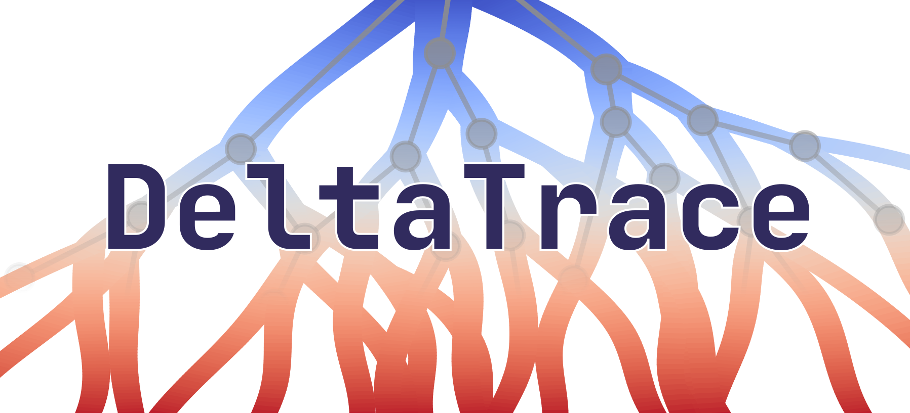
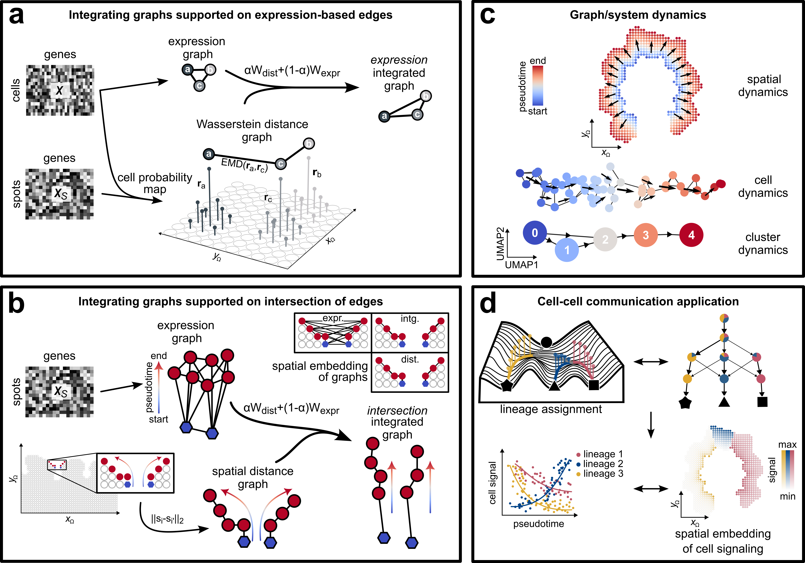

<p align="center">
  
</p>

<p align="center">
  <em>spatially-regularized trajectory inference for single-cell and spatial transcriptomics</em>
</p>

## Overview


**DeltaTrace** is a trajectory inference (TI) method regularized by spatial distance for single-cell RNA sequencing (scRNA-seq) and spatial transcriptomics (ST) data. It infers the trajectory of cells and their respective lineage assignment using Essid and Solomon's quadratically-regularized graph optimal transport ([QROT](https://doi.org/10.48550/arXiv.1704.08200)).

**DeltaTrace** is designed to run on an **integrated** cell graph, where two cells stay connected only if they are close both in expression and in physical space. The same pipeline also runs on the expression kNN graph alone, e.g. when no spatial prior is available (`dt.pp.graphs(adata)` without a distance matrix).

## Key Innovations

1. scRNA-seq cells carry no tissue coordinates. Given a cell-to-spot mapping onto a paired ST section (from any probabilistic mapping method), **DeltaTrace** takes the *Earth Mover's distance* between cells' resulting spatial distributions as an inferred physical proximity.

2. For TI, transport runs on the integrated cell graph rather than a learned embedding. QROT returns a dual potential (taken directly as pseudotime) together with the primal directed flow; solved from *one second-order conic program*: taking only seconds to solve, with no time-series data or neural network to train.

## Installation

**DeltaTrace** requires Python >= 3.12.

<!-- Once 0.1.0 is on PyPI:
```bash
pip install deltatrace
```
-->

```bash
git clone https://github.com/ajpiy/deltatrace.git
cd deltatrace
pip install .
```

For development, `uv sync` instead installs the pinned environment with the test tools.

## Inputs

- **`adata`**: preprocessed cells (`AnnData`), with cluster labels in `obs["clusters"]` (or pass `cluster_key=`) and a scanpy neighbor graph (from `scanpy.pp.neighbors`).
- **`adata_dist`** (optional): an `AnnData` whose `X` holds the cells' `(n_cells, n_cells)` inferred or observed secondary distances, indexed by `adata`'s cell names (matched automatically):
  - *ST at cell resolution*: the Euclidean distance between cell coordinates ([`examples/spatial_transcriptomics.ipynb`](examples/spatial_transcriptomics.ipynb)).
  - *scRNA-seq with a paired ST section*: map cells to spots (any probabilistic mapper, e.g. Tangram), then `dt.pp.wasserstein` ([`examples/single_cell_rna_seq.ipynb`](examples/single_cell_rna_seq.ipynb)).

`dt.datasets.crypt()` returns a small synthetic pair in this form: a crypt-shaped tissue whose two walls run the same expression program, with `["progenitor"]` as the source and `["fate_A", "fate_B"]` as the sinks. [`examples/quickstart.ipynb`](examples/quickstart.ipynb) walks through it.

## Usage

```python
import deltatrace as dt

# builds the expression and spatially integrated graphs into one object
ad_intg = dt.pp.graphs(adata, adata_dist)

# runs: endpoints -> qrot -> velocity -> lineages on the intersection graph (intr)
# sources / sinks: lists of progenitor and terminal cluster labels
dt.tl.trajectory(ad_intg, sources, sinks, graph="intr")

# pseudotime with the flow field
dt.pl.pseudotime(ad_intg)
```

*no annotated sinks are needed if you run source-only* (`sink_clusters=None`); *it ranks the clusters by terminality so one can pick cell fates.*

## Public API

**DeltaTrace** mirrors [scanpy](https://doi.org/10.1186/s13059-017-1382-0)'s namespace layout, and every stage `tl.trajectory` composes is also callable on its own:

| Namespace | Functions |
|-----------|-----------|
| `dt.pp` (preprocess) | `wasserstein`, `integrate`, `graphs` |
| `dt.tl` (tool) | `trajectory`, `endpoints`, `qrot`, `compute_velocity_grid`, `lineages`, `terminality`, `widest_path`, `cluster_trajectory` |
| `dt.pl` (plot) | `pseudotime`, `velocity`, `endpoints`, `lineages`, `cluster_trajectory` |
| `dt.datasets` | `crypt` |

## Citation

Manuscript is in preparation. Until its release, please cite the software via
[`CITATION.cff`](CITATION.cff) (GitHub renders it at "Cite this repository" under the "About" section).

## License

See [LICENSE](LICENSE).
